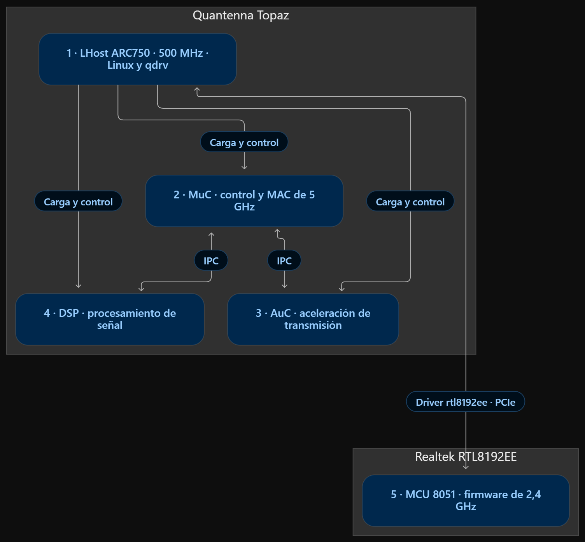

# Preserved component notes

Editorial copy of the previous README. Workstation paths are normalized; original source and immutable evidence are not modified. Earlier status claims belong to their named checkpoints, not the live device. Start with the current [README](../README.md).

# HGW500 2.4 GHz Driver Reverse Engineer

Repositorio privado de la reconstrucción documentada del driver Realtek
RTL8192EE, rtl_pci y rtlwifi para ARC700 y Linux 5.10.260. Se materializó el
3 de noviembre de 2026 desde el commit
`149bf5abd887a33264b9dc6f431c4820d2f3d052` del repositorio
`apelsito/Realtek-2.4GHz-HGW500`, rama `main`.

Contiene 366 entradas de función únicas exportadas por REA, equivalentes a
370 símbolos de función de los tres módulos de referencia. Cada entrada
conserva pseudocódigo C, ensamblador y el reporte REA comprimido. La referencia
proviene de la imagen F367r9 y del contexto F363 retenido. Las fuentes
reconstruidas y los originales disponibles se conservan con sus licencias.

## Navegación

| Carpeta | Contenido |
| --- | --- |
| `evidence/rea/public-export-20261022T132100Z-r2/` | 366 C, 366 ensambladores y reportes REA, con manifiesto y hashes |
| `original/` | Fuentes upstream, overlay original y cabeceras API preservadas |
| `src/baseline-exact/` | Fuentes que reconstruyen exactamente la referencia modular |
| `src/overlay/` | Cambios y receta de reconstrucción |
| `build-context/f363/` | Contexto mínimo y cabeceras, con manifiesto |
| `evidence/reconstruction-exact-paired.json` | Comparación histórica de 27 unidades y cuatro módulos en dos builds |
| `evidence/ops-*` y `evidence/callbacks-*` | Tablas de operaciones y registros asíncronos recuperados |
| `docs/ORIGINAL_COMMENTS.md` | 3.630 comentarios literales, con archivo y línea |
| `scripts/` y `tests/` | Exportación, reconstrucción y verificadores offline |

La comparación exacta es evidencia histórica del 22 de octubre. En esta
organización se verificaron de nuevo 625 archivos originales, los rangos de
bytes de los 3.630 comentarios y los 1.104 archivos de la exportación REA
por sus hashes. Las 16 pruebas de herramientas terminaron correctamente.
El pseudocódigo mantiene direcciones y ensamblador para contrastarlo.
La reconstrucción compilable está en `src/baseline-exact/` y su receta en
`docs/RECONSTRUCTION.md`.

## Comprobación

```powershell
python scripts/verify_original_sources.py
python scripts/extract_original_comments.py --check
python scripts/verify_rea_public_export.py --input evidence/rea/public-export-20261022T132100Z-r2
python -m unittest discover -s tests -v
```

El contexto completo del kernel y el toolchain ARC se proporcionan como
entradas explícitas a `scripts/reconstruct_baseline.py`. `--help` documenta
las rutas. La reconstrucción conserva la procedencia F363/F367r9 y no
atribuye este resultado al driver candidato Linux 7.3.

El candidato Linux 7.3 vigente está en el repositorio hermano
`Realtek-2.4GHz-HGW500`. El microfirmware 8051 tiene su propio repositorio
`hgw500-2ghz-driver-microfirmware`. La aceptación física de cada artefacto
se registra desde HGW500.

`SOURCE_ORIGIN.json` fija esta selección y sus hashes.
`docs/SOURCE_README.md` conserva la documentación original de la rama
importada. Las fuentes mantienen avisos SPDX y copyrights en `NOTICE.md`,
`LICENSE` y `original/linux-5.10.260/COPYING`.

## Arquitectura de procesamiento del HGW500

El [esquema y sus evidencias](../docs/HARDWARE_ARCHITECTURE.md), conservados el
3 de noviembre de 2026, identifican una CPU LHost ARC750 a 500 MHz y cuatro
coprocesadores: MuC, AuC, DSP y la MCU 8051 del RTL8192EE. Incluyen el inventario
SPI NOR de 16 MiB y el perfil DDR3 OEM de 128 MiB, con fuentes y límites.



El diagrama es una vista conceptual. La etiqueta qdrv describe el papel del
host; la integración física de 5 GHz en Core Boot R1 sigue pendiente.
